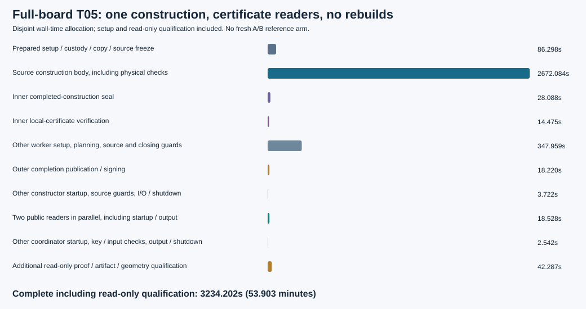

# Full-board T05 outer certificate acceptance — PASS

The single authorized run completed with one source constructor and two public-only certificate readers: **zero full rebuilds, zero reference/comparison arms and no T02 rerun**. All 7,730 route decisions and 7,991 attachment outcomes are accounted for. There are 771 grown routes and 6,959 KEEP routes. Actual proposal issuance executed 949 original physical checks; the two outer readers executed **zero physical rechecks, source reparses, scene compositions or construction calls**. Each reader consumed all 771 exact local containment/chain records.

**Complete execution including setup: 3191.916 s = 53m 11.92s.** Additional read-only qualification took 42.287 s. Including it gives **3234.202 s = 53m 54.20s**, before the separately recorded tiny report-render overhead. The standalone T05 run meets one hour. Upstream T02 was reused, so this is not a fresh combined T02→T05 elapsed time.

## Disjoint measured time

| Phase | Seconds |
|---|---:|
| Prepared setup / custody / copy / source freeze | 86.298 |
| Source construction body, including physical checks | 2672.084 |
| Inner completed-construction seal | 28.088 |
| Inner local-certificate verification | 14.475 |
| Other worker setup, planning, source and closing guards | 347.959 |
| Outer completion publication / signing | 18.220 |
| Other constructor startup, source guards, I/O / shutdown | 3.722 |
| Two public readers in parallel, including startup / output | 18.528 |
| Other coordinator startup, key / input checks, output / shutdown | 2.542 |
| Additional read-only proof / artifact / geometry qualification | 42.287 |
| **Complete including read-only qualification** | **3234.202** |

The constructor process wall was 3084.547 s (51m 24.55s), including physical construction, inner sealing/verification, completion publication, interpreter and output. Both public readers ran concurrently in **18.528 s**. Individual fresh-process readings were 18.422 and 18.417 s; they overlap and are not added together. The external stopwatch includes coordinator/interpreter/storage readiness, key creation, cache/journal work, all workers and output. Prepared setup 86.298209833913 s is added once.

The inner consumer still performs local certificate verification (14.475 s, already included). Outer readers still authenticate and read actual bytes and local proofs. What has disappeared is full reconstruction and repeated physical checking in those readers. Inclusive construction observations such as blend requests (1,371.412 s), proposal checks (346.528 s), ledger issue/commit and sealing overlap with the rows above and must not be added again. This was one profiled run without a new comparison arm; no controlled A/B savings claim is made.

## Actual copper, proof and custody reread

The read-only inspector authenticated the public signature, actual completed stage, all frozen inputs, 813 current producer files and their retained source capsule, the immutable plan/latch, source bytes, named predecessor receipts, full dependency closure and ordered acceptance chain. It independently remeasured all **771 actual window witnesses** and exact patch-in-certified-region containments. Maximum outside-window area was 5.8918336236809341e-18 mm², below the unchanged 1e-12 mm² window policy. Exact enclosure containment has no small-area waiver.

Actual stored before/after copper and all **771 patch WKB blobs are byte-identical to the already completed full-board result**. All 7,730 route statuses and attachment outcomes match that retained result; per-route and aggregate ADDED-copper difference are therefore **0%**, within the 20% limit. No historical reference constructor was run. Attachment outcomes: 1,527 TREATED_VERIFIED, 6,366 ALREADY_SATISFIED_VERIFIED and 98 BLOCKED_CLEARANCE_OR_BOUNDARY. Removed copper area is 0 mm². Blocked cases remain blocked; safety policy was not relaxed to grow them.

The current process-local ledger records 771 commits, 1,542 local consumptions, two complete replays, 792 issued successful proposal receipts and 949 physical checks. The root signs only after original construction, real canonical composition, live inner HMAC authentication and all final worker guards complete. Session/HMAC/public signature schemas intentionally differ from old reconstruction receipts. No `audits/t05/1.json` or `2.json` was fabricated. Repeated-build determinism remains a separate audit, not performed here.

## Configuration and limits

Configured memo: **510.5 MiB shared geometry + 0.5 MiB inner ledger/index + 1 MiB outer read journal = 512 MiB**. Actual inner metadata peak was 397,671 bytes below its 524,288-byte partition; ledger peak 237,977 bytes and stage metadata peak 3,351 bytes are nested in it. The read journal is 6,688,768 bytes on disk, with a bounded SQLite resident cache. Each public reader accounted for 27,803,648 bytes of read-manifest metadata within its separately bounded 64 MiB pool. Configured memo is not process RSS or transient geometry. The general geometry LRU peak was not retained separately; no peak value is invented.

This is the bank-independent **source spindle constructor**, not full-board fitting from the 160-route measurement bank. No fitting bank was used. The scope is the exact saved legacy T04/T02 checkpoint: source/clearance/write scope/attachment/pin/void/assembly guards are preserved, while historical assembly producers remain explicitly historical. Pin intent remains **UNDECLARED**. Connected/post-junction finishing, Gerber export/reparse, rendering and delivery were NOT_RUN. Electrical/manufacturing acceptance is NOT_ESTABLISHED. Independent reviewer: NOT_RUN / CHANNEL_UNAVAILABLE. This qualification does not silently change the normal connected operator/default profile.

## Evidence identities

- Source: `207a51318f103190a4d61e76f4a0457fcfd11fd3db560c9439dd2f5f460f9b90`
- Saved T04: `19be422696f74118686322c9bc0823b75a5eaeae97c84173a97554fc8036cc77`
- Completed input T02: `ee56b30525c73e6f02b986e4eaf5d988e726a1547f9e88483b2b3046e1795070`
- Current producer: `007cf21c8b0356bd525975be76a214d2c6bcbb80ca744681db6cb3cff4ef9d9b`
- Actual T05: `729d60c77eee51f511e9e34c27e543b83ac20d8562a3a0c90e36c76bcbb53fdc`
- Signed completion: `75fc53a26937be5d5c82b2ded9513ad806fb36418d6df412553388ef52e3498d`

[Result](RESULT.json), [external stopwatch](OUTER_TIMING.json), [actual construction receipt](legacy/audits/t05/construct.json), [reader 1](CONSUMER_1.json), [reader 2](CONSUMER_2.json), [publication](PUBLICATION.json), [signed completion](OUTER_CERTIFICATE.json), [independent readback](READBACK.json), [extra readback stopwatch](READBACK_TIMING.json), [reproducible inspector](verify_terminal.py), [timing data](TIMING.json), [source manifest](PRODUCER_SOURCE_MANIFEST.json). The 133 passing integration controls are [retained separately](../../t05_outer_integration_20261119.7jycxkg7/PREFLIGHT.json).

All old completed jobs, inputs and source files remain unchanged. No retry, resume, extra reference run or full rebuild occurred. This report and inspector add engineering evidence only.
