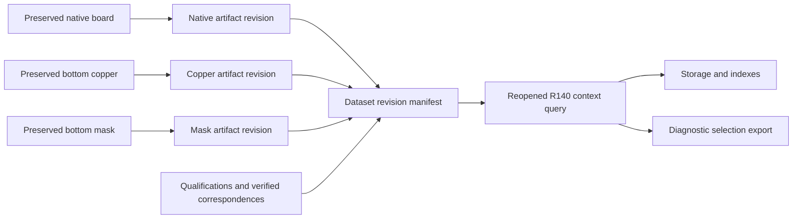

# Common catalogue: minimum R140 context slice

This is the retained **definition checkpoint**. Its starting-state gaps and NOT_IMPLEMENTED observations below are historical. The subsequently authorized implementation, real persisted execution and manual reproduction commands are in [DELIVERY.md](DELIVERY.md); the final decision is recorded separately in [COMPLETION_AUDIT.md](COMPLETION_AUDIT.md).

Definition and infrastructure review · 2026-10-18. The user-directed payload-limit change is implemented; the common catalogue slice itself remains a definition. This defines the next implementation slice. It does not report a newly implemented client object store or a passed reopened-client retrieval case. Existing dataset intake, +/− behavior, workbench publications and frozen engineering results remain unchanged.

The machine-readable definition is [common_catalogue_slice_v0_1.json](../../contracts/common_catalogue_slice_v0_1.json). The [observed four-role example](r140_context_observed.json) uses actual source identities and measured Gerber bounds, while keeping unimplemented persistence and object-level correspondence explicit. Read-only probes and existing-infrastructure test results are under `out/common_catalogue/definition_review/`.

## The useful boundary

Implement one durable context retrieval, using the existing revision catalogue. The first client materialization covers R140 on B.Cu and the selected B.Mask opening. Its four returned roles are **R140.1, its straight connected trace, R140.2 and the opening for R140.1**. Retain the R140 footprint as a parent dependency. The other four dataset groups and their recorded Storage & indexes capabilities continue to work. This is a common projection over retained records, not a rewrite or pruning of existing inventories. Existing object kinds and unsupported source annotations stay available.

Do not require a universal PCB taxonomy, full-board extraction, an electrical netlist, native graph promotion or general board reassembly to deliver this slice. The complete original files stay preserved even though extracted objects and spatial coverage are bounded. Qualification records may concern other regions or artifacts without expanding this geometry coverage.

## Infrastructure review

| Theme | Existing implementation and current evidence | Minimum extension |
|---|---|---|
| Discovery and source identity | `source_locators.py` retains exact UTF-8 byte occurrences; `native_inventory.py` inventories supported and unsupported objects | Extract the bounded R140 native occurrences from the original board, with original offsets; preserve modern named-net syntax and qualify this one back-side rectangular-pad pose |
| Structured storage | `revision_catalog.py`: CAS payloads, SQLite revisions/objects/relations, foreign keys, manifest checks, source excerpts, reopen and rollback tests | Payload ceiling increased to 128 MiB; the 72,514,570-byte source admits and reads back. Retain original occurrence identities |
| Physical grouping | `spatial_context.py`: per-copper-layer Rtree candidates, exact GEOS contact/distance, recomputed components including splits | Use only qualified B.Cu geometry for the bounded context; preserve scope and omissions. R140.2 is nearby protected context, not part of the R140.1/trace contact group |
| Component and native-group references | `catalog_selection.py`: parent dependencies, explicit native PCB_GROUP expansion, ambiguity/cycle guards | Keep footprint ownership, native group membership and computed physical grouping separate. No native group is required for this case |
| Retrieval and selective output | Revision/property/layer lookup, exact region queries, explicit selection, source-record extraction and budgets already exist | A four-role resolver plus a saved diagnostic selection bundle. General importable KiCad reconstruction is not implemented by these selectors |
| Qualification | Existing inventory omissions, source-bound report excerpts, client ROI comparisons, L2 discrepancy and warning evidence exist | Store/query them beside the records through a common qualification envelope and explicit cross-source match records |
| Storage & indexes UI | Existing viewer shows actual stage receipts, stored objects, query samples, physical/native groups, geometry and source excerpts | Center the new client view on the reopened four-role result and its stored query/export receipt; retain current datasets' inspectors |

I reran 33 locator, inventory, catalogue, selection and spatial tests, including the new write/read size-boundary test. All pass. They establish reusable infrastructure behavior, not client acceptance. The source inspection and probes found the following; the size issue is now resolved:

1. **Source size, resolved:** the original 64 MiB ceiling rejected the 72,514,570-byte board with `PAYLOAD_BUDGET_EXCEEDED`. At the user’s direction, the existing shared payload ceiling is now **128 MiB (134,217,728 bytes)**. The same limit guards both writes and reads. Actual source admission, hash identity and full byte-for-byte readback pass. Boundary tests reject oversized writes and reads. No chunked storage, separate source backend or synthetic mini-board is needed. The earlier rejection and source snapshot remain under `out/common_catalogue/definition_review/before_limit_change/`. This is CAS admission/readback, not client object ingestion.
2. **Back-side geometry:** the existing inventory returns `BACK_FOOTPRINT_TRANSFORM_NOT_QUALIFIED` for both R140 pads. Keep this status until this exact pose/shape profile has independently checked coordinate and geometry witnesses. Raw local pad positions, footprint pose and UUIDs can be retained before geometry is qualified. Preserve the footprint’s own Reference on its container record as well as its children’s parent occurrence links.
3. **Named nets:** both pads use `(net "name")`. The current extractor expects a numeric code and returns `net_name: null`. Preserve the string and its source location; use `net_code: null` when no code exists. Test both this syntax and the previously supported numeric form, including unassigned code zero.
4. **Cross-source relationships:** catalogue object and relation foreign keys are scoped to one source revision. A native pad and a Gerber flash cannot be inserted as endpoints of one existing same-revision relation. Keep per-artifact revisions and join them with a small immutable dataset manifest plus correspondence records.
5. **Mask and export coverage:** the spatial adapter indexes copper only. Retrieve the mask by its stored correspondence/identity or the existing exact region selector for B.Mask; do not treat it as copper connectivity. Selection currently returns diagnostic records; the serialized diagnostic context bundle is a small new output step, not a general native exporter.

The current pipeline driver also has hard-coded source selections and calls the whole-source inventory. Add a bounded client adapter; do not feed the entire client through that driver and call the existing synthetic/public coverage proof applicable.

## Identity and minimum record contract

The catalogue needs three record families: **objects**, **relations/correspondences** and **qualifications**, under a revision manifest. Layers and net annotations remain fields; no separate universal net/component database is required.

| Field | Meaning and rule |
|---|---|
| `dataset_id` | Existing logical dataset identity, e.g. `client:vme-wren:20261016:v1`; this alone does not identify one content revision |
| `source_revision` | SHA-256 of the complete original artifact bytes. Paths are locators, not identity |
| `artifact_revision` | Existing catalogue manifest hash for one source plus extraction/profile/geometry configuration |
| `dataset_revision` | Hash of an immutable manifest pinning the native, B.Cu and B.Mask artifact revisions, layer/coordinate conventions, correspondence and qualification payload hashes |
| `object_id` | Preserve the existing `source_sha256:bytes:start:end` identity. Native UUID, `R140.1` and parser ordinal are lookup metadata scoped to the source revision |
| `kind`, `representation` | Minimum kinds: footprint, pad, segment, Gerber flash, Gerber line. Mask opening is a Gerber feature with an opening role. Preserve the parser's original kind |
| `parent_id`, `reference`, `pin`, `native_id` | Exact native occurrence parent and native UUID, plus source-declared component/pad references. Duplicate/missing references are explicit, never arbitrarily resolved |
| `net_name`, `net_code`, `net_basis` | Source annotation and its provenance. Preserve spelling/path and null versus unassigned. Equal names do not independently establish electrical continuity or merge artifacts' net identities |
| `layers`, `layer_role` | Preserve original layer spelling/function and declared membership; separately record canonical B.Cu/B.Mask mapping and mapping evidence |
| `position_mm`, `endpoints_mm`, `bounds_mm` | Board frame: X right, Y down, millimetres; bounds are `[xmin,ymin,xmax,ymax]`. Unsupported geometry is null with a reason. A trace uses endpoints, not an invented pad center |
| `geometry_sha256`, `geometry_basis`, `coverage` | Bound WKB, qualified nominal native or actual Gerber feature geometry, profile/error budget and bounded materialization scope. Display simplification is separate |
| `source_span`, `state_dependencies` | Exact original bytes plus interpretation dependencies. A Gerber D01/D03 trigger alone is insufficient: retain prior coordinate/aperture, attributes, polarity, units/format, transforms and parser version |
| `qualification_refs`, `match_refs` | Hash-bound qualifications and correspondence predicates. Preserve unknown, ambiguous and failed results alongside matched records |

One native pad occurrence can declare several layers. Store layer instances separately from its source-object identity; do not clone a pad ID into several source objects. In particular, do not copy copper geometry into B.Mask just because the native pad declares B.Mask membership. A mask opening has its own qualified geometry and source feature.

Gerber feature locators in the observed example identify unique plotting trigger commands. Their complete interpretation is established only by parsing the entire hash-bound artifact and retaining state dependencies. Parser ordinals are corroborating metadata, not global identities. Unsupported composite constructs stay source-located and unqualified rather than being assigned invented one-command identities.

Native board coordinates are already in the chosen frame. The current Gerber comparison uses the explicit map `(x,y) -> (x,-y)`. Keep original coordinates/units and the reversible transform; no best-fit alignment or silent offset is allowed. Native footprint-local pose is a different transform and needs its own qualification.

## Reuse the store; add a small dataset envelope

Keep the existing per-artifact `RevisionCatalog` and its revision-safe object/relation tables. Add content-addressed JSON sidecars for the dataset envelope, cross-artifact correspondences and qualifications; pin them from the dataset manifest. This avoids changing same-artifact foreign-key semantics or building another graph database. Spatial indexes remain rebuildable derivatives. DB0 stays SHADOW_ONLY.

A correspondence record names both endpoint artifact revisions and object occurrences, relation type (`geometry_equivalent`, `opening_for`, or an explicitly scoped association), predicate, source hashes, transform, profile/kernel versions, tolerances, measurements, cardinality and evidence. An aggregate ROI equality receipt is qualification of the region; it is not proof of every UUID-to-feature link in it. The mask only carries `.C=R140` in the observed file; it has no `.P=R140,1`. Its opening association therefore needs unique geometry/anchor evidence, not a fabricated pin attribute.

Cross-source verification is local and specific. Keep source conversion provenance, independent schematic/netlist intent, global equivalence and manufacturing acceptance separate.

## Qualification is data

Retain a qualification record with: stable content identity; owning source/artifact revision; object, region or artifact scope; parser/profile and versions; original message/report hash and exact source/JSON-pointer location; severity/code; geometry availability; matching predicate/tolerances/measurements; and status. Preserve the complete original report. Warning count is not a substitute for the warnings or their provenance; if only an aggregate count is retained, label it aggregate-only.

Examples already present are the L2GND region's twelve source-only flashes and top-copper's 304 zero-width interpolation warnings. Keep them attached to their own sources/regions. Neither has to be repaired before storing or querying the R140 context. Do not label every object in a problematic layer mismatched when only a region was compared.

Current `CompletionParser.warn()` raises. Preserve that strict qualified-geometry behavior. A qualification-ingestion boundary may save the failed/unsupported parse report and raw source identity while withholding derived geometry. Silencing warnings to obtain a geometry PASS would violate this contract.

Use independent dimensions: persistence committed/failed; query complete/truncated/cancelled/error; geometry available/unsupported/not run; match verified-in-scope/mismatch/ambiguous/not established/not run. A successful database query is not an engineering verdict. A known mismatch is a valid stored finding. Unresolved qualification may be committed; broken source hashes, inconsistent manifests and partial publication may not.

## One retrieval acceptance case

**Request:** in a fresh process, open one explicit persisted dataset revision and retrieve the context for native reference R140, pin 1, layer B.Cu. Resolve exact identities first; use the spatial/contact predicates for their named purposes. No selection, grouping or query grants write permission.

| Returned role | Exact known identity / observed board-frame position | Required evidence in the implemented result |
|---|---|---|
| R140.1 | Native pad UUID `6d70837f-2559-4ddc-9cf3-9c9ba4e52774`; source copper ordinal 638; Gerber anchor `(117.211125,230.997175)` mm | Native occurrence, source flash, separate geometry/match states, original net annotation `/io_drivers_fp/bank0/EN7` |
| Connected trace | Native segment UUID `380ef8d4-0d79-4725-9f15-c2be4b752ca0`; source copper ordinal 8905; endpoints `(117.211125,230.997175)` and `(117.211125,231.667175)` mm | Exact segment/line identities and qualified same-layer contact witness; not net-name inference |
| Nearby R140.2 | Native pad UUID `bfec81ff-5cd3-4f92-a38f-32a99442e746`; source copper ordinal 639; anchor `(116.271125,230.997175)` mm | Distinct pad occurrence and source flash; original net annotation `P3V3`; nearby but outside the R140.1/trace contact group |
| Mask opening | B.Mask source ordinal 542, `.C=R140`; anchor `(117.211125,230.997175)` mm | Its own source occurrence and mask geometry, unique opening-for association, and native pad's B.Mask membership; no invented standalone native mask UUID |

The supplied Gerber probe observes zero pad/trace distance and approximately 0.36 mm between the two pad geometries. These help define the case; they are not a persisted native/Gerber matching result. The original aligned state is the input, not the artificial +0.35 mm challenge.

**Storage/retrieval acceptance** requires four named roles, the R140 parent dependency, original identities and bytes, required fields/explicit unknowns, all applicable qualifications, deterministic selection digest and complete-in-scope results after process exit/reopen. Reuse the original B.Cu/B.Mask ROI: `[115.8,230.45,118.1,231.8]` in board millimetres. The context universe is bounded to this extraction; “nearby” is not a claim that every nearby board object was materialized.

**Correspondence qualification** is recorded separately for each role/link. Claim VERIFIED_IN_SCOPE only after a unique, tolerance-bounded object-level witness has been produced. The planned witness profile uses 0.001 mm position/Hausdorff tolerance with a declared composition error budget and symmetric-difference measurement; no area-only PASS may hide a displaced thin trace. An unknown or mismatched link may be persisted and returned, while that link's qualification remains NOT_ESTABLISHED or MISMATCH. Closing the intended fully linked positive example additionally requires its mandatory pad/trace/opening witnesses to qualify. Neither proof establishes independent net intent or whole-board equivalence.

**Selective export** produces a diagnostic manifest containing the four roles, parent dependency, exact source references/excerpts, geometry hashes, relationship/match/qualification records, extraction coverage and query receipt. Reopening that exported bundle must reproduce the same role identities and result digest. It is not advertised as a standalone KiCad board or manufacturing artwork.

Required controls: changed CAS bytes; stale artifact revision mixed into a dataset; duplicate R140.1 reference; missing trace; same net name without physical contact; R140.2 incorrectly merged into the contact group; ambiguous mask anchor; reflected/translated coordinates; omitted or truncated result; missing qualification; partial publication failure; and caller mutation of returned records. Each must reject or retain the appropriate explicit unknown/mismatch, never silently pass. Persist the L2 mismatch and a parser-warning/unsupported record without blocking the unaffected R140 query.

## Storage & indexes narrative

Use **Find records → Inspect relationships/groups → Reopen the stored revision → Export selected context** as the tab's main narrative. Keep dataset preservation and input interpretation in Datasets / Ingestion; keep correction/control visualization in Cases.

The central result is a four-row context table with native/Gerber source identities, normalized position/bounds, geometry basis, match status and qualification links. Selecting a row focuses its actual geometry. Contact, proximity, footprint ownership and opening association have different labels and witnesses. The stored revision, backend, query bounds/completeness, source hashes and result digest are inspectable details. No new primary tab or duplicated correction replay is needed.

Retain existing legacy/public recorded inspectors; use availability labels when a dataset lacks native, Gerber or qualification data. Do not relabel recorded samples as a newly executed reopened-client query.

## Small implementation order

1. Reuse the now-sufficient 128 MiB payload store; add bounded native selection, named-net annotation and the exact back-side pad profile while retaining existing contracts/tests.
2. Add bounded Gerber feature records and interpretation dependencies using the maintained parser. Materialize only the case's objects and dependencies; preserve outside-slice coverage limits.
3. Persist the dataset envelope, qualification sidecars and correspondence witnesses. Keep unresolved findings ingestible and immutable.
4. Execute the fresh-process R140 retrieval and diagnostic-export acceptance, including controls, then connect its receipt/result to Storage & indexes.

At this definition checkpoint, materialization, correspondence and reopened/exported acceptance were still implementation work. Its only production change was the requested 64-to-128 MiB payload ceiling. Later implementation and audit results are recorded in the delivery and completion documents linked above; the original definition evidence remains retained.
