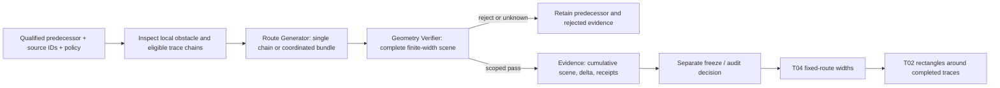

# T03 architecture and code consolidation — 2026-10-29

Status: source-inspected architecture documentation, not new route execution or
qualification. The owner authorizes this consolidation and a proposed ABI suite;
no ABI function implementation is included. See the [ABI proposal](T03_AGENT_ABI_PROPOSAL.md)
and [consolidation decision](T03_CONSOLIDATION_DECISION.md).

## Current lane and authority

The current order is **T01 → T03 when needed → T04 → T02 → cumulative validation**.
At T03, preserve the qualified T01 lands and all other protected predecessor
copper. T02 has not yet enlarged rectangles in this sequence. An already present
protected land remains fixed regardless of stage label. T03 must not import
historical T02 v69 as an implicit predecessor or shrink accepted lands.

Current C02 result232 uses **no T03 route changes**; T04 result222 and subsequent
T02 results226/229/232 are real model-space construction, not T03 routing evidence.
Human visual acceptance of result232 is recorded. Independent packet234 audit is
still running, per the owner's latest correction; no verdict is recorded here.
A hash-integrity check is not geometric audit completion.

T03 is not absent from the repository: bounded single-chain construction,
source verification, a pinned launcher and cumulative rendering exist. Their
historical C2 contracts are narrower than a general Route Generator. T02 geometry
implementation exists; T02 ABI execution remains deferred. This distinguishes
implementation, current execution, adapter availability and qualification.

## Inspected implementation map

| Responsibility | Existing file and symbol | Actual boundary / consolidation treatment |
|---|---|---|
| Native segment/arc path and cut ports | `src/t03_route_preflight.py`: `Primitive`, `SourcePath`, `CutPort`, `enumerate_cut_ports` | Bounded adaptive chain preparation exists. `Primitive` locks width to 0.10008 mm; not generic arbitrary-width support. Keep historical constants unchanged. |
| Candidate construction | same file: `enumerate_candidate_specs`, `construct_candidate_centerline_source_spans`, `buffer_centerline`, `candidate_source_copper_by_id` | Deterministic bounded single-chain primitives; not a qualified recursive bundle router. |
| Search orchestration | `src/t03_c2_search_executor.py`: `build_locked_search_domain`, `make_source_bound_c2_archive_factory`, `make_trusted_candidate_evaluator`, `execute_ordered_search` | Source/inventory/policy locks and finite ordered domain. Historical fixed offset grid is not the proposed heuristic strategy. |
| One-shot authorization boundary | `src/t03_c2_search_run.py`: `verify_preflight_bindings`, `launch_one_bounded_search`; `src/t03_c2_search_guard.py`: `verify_executable_integrity`, `run_guarded` | Pinned historical packet, code, environment and one-shot execution identities. Do not retarget or relax pins to run current scenes. Python guard is local integrity control, not an external security authority. |
| Source-bound verification | `src/t03_c2_source_verifier.py`: `verify_c2_source_obligations`, `verify_saved_candidate_bundle`, `verify_saved_candidate_archive_from_c2_package` | Checks saved source/land partitions, patch/contact obligations and historical ledger. Reuse concepts; historical policy/ledger obligations do not automatically apply to the new sequence. |
| Candidate archive | same file: `write_candidate_geometry_archive`, `verify_saved_candidate_archive` | Materialized geometry and identity manifests; retain rejected evidence. Current raw geometry serialization remains platform-sensitive until replayed. |
| Cumulative review | `src/t03_c2_cumulative_result.py`: `render_verified_cumulative_scene` | Full resulting scene from an archive after trusted upstream PASS; archive integrity and source partitions checked. Rendering is not geometric/electrical qualification. |
| Local chain/contact evidence | `src/trace_chain_contacts.py`: `qualify_chain`; `src/trace_endpoint_inventory.py` | Source contacts and ports support candidate preparation; no inferred net permission. |
| Parallel relationship proposals | `src/parallel_trace_relations.py`: `parallel_relation`, `relation_groups`; `src/parallel_curve_relations.py`: `parallel_curve_relation` | Sampled selection helpers; explicitly not a continuous parallelism or clearance certificate. |
| Complete-width stage | `src/primary_parallel_cohorts.py`, `src/source_offset_width.py`, `src/bounded_width_solver.py`, `src/prepared_width_scene.py` | T04 selection/construction/checking. A width cohort is not automatically a T03 movement group. Do not put width optimization in T03. |
| Existing ABI | `src/agent_abi/{models,registry,service,ports}.py` | Existing v0.1 read/plan/evidence skeleton; `cam_run` and `cam_verify` remain unavailable. Proposed T03 names are not registered or implemented. |

Line numbers, symbols, local imports and SHA-256 values for this inspected worktree
are recorded in [SOURCE_INVENTORY.json](SOURCE_INVENTORY.json).
Some mapped T03 files are existing uncommitted worktree code, not implementation
introduced by this documentation commit; the inventory binds their exact bytes.
Untracked files are present; HEAD alone does not identify the implementation.
No whole-codebase cleanliness, runtime parity or generic routing claim is made.

## Unified target architecture

The generator owns actual geometry changes; the verifier evaluates them; the
evidence layer records them. There is no separate post-routing bundle repair
phase. Assembly replaces selected spans atomically:
**result = unchanged source parts ∪ verified replacements ∪ protected lands**.
Do not simply union old and new routes. A removed source span must be justified
by the plan; protected and unrelated copper remain byte-bound.

### Candidate strategy and bounded adaptation

1. Identify a growth-related or separately authorized local objective from exact
   source operands, not every old small gap. KEEP and pre-existing excluded gaps
   are not automatic repair targets.
2. Derive the direction away from the obstacle surface and measure free space on
   the opposite side. Try the least displacement satisfying the objective first.
   Deterministic tie breaks: declared objective rank, affected source count,
   extension length, displacement magnitude, then source identity.
3. If fixed provisional cut ports prevent a solution, extend only through
   demonstrably connected eligible source spans to a suitable port. Preserve the
   initial and expanded patch definitions and the reason for each extension.
4. If the displacement is blocked by movable traces, expand the movement group
   within its preauthorized corridor and bounds. A fixed land, protected branch,
   unresolved contact or exhausted limit terminates that candidate.
5. Reject or retain the predecessor when the finite budget is exhausted. Report
   `NO_IMPROVEMENT_FOUND` separately from `NOT_ESTABLISHED` or execution failure.
   Avoid an unmotivated Cartesian product of offsets and ports. A finite search
   result does not establish global optimality.

Every plan must bind numeric maximum extension, added spans, movement-group size,
recursion depth, displacement, corridor polygon, candidate count and deterministic
geometry-evaluation budget. No unset/unbounded field defaults to unlimited.
Historical 0.5-mm/four-span limits are historical fixture bounds, not a new general
authorization. Wall-clock timeouts abort safely but cannot determine a claimed
reproducible geometric ranking.

### Parallel-bundle preservation

The proposed common reference curve and signed offsets preserve member ordering,
individual original widths and specified copper-to-copper spacing in the shared
movement region. Both sides and all nonlocal modified spans must clear obstacles.
A shared displacement field alone does not guarantee parallelism everywhere.
Check tangent alignment, ordered offsets, spacing and self-intersection with
explicit policy-bound tolerances and curve error bounds. Sampling alone is not
continuous proof; report NOT_ESTABLISHED if the verifier cannot bound the gaps
between samples. Cut-port transitions are separate regions with explicit limits;
reject when exact parallelism is impossible unless a bounded transition exception
was independently authorized and verified. No silent exception or electrical
permission follows from physical-component membership.

These are target requirements, not evidence that recursive movement groups,
common-offset generation, continuous parallelism verification or generic-width
routing have been implemented or qualified.

## Consolidation plan, without changing pinned experiments

Keep historical modules and out/ experiments intact. Treat `t03_c2_search_run` as
a historical adapter, not a general API. In a later separately authorized code
slice, extract reusable source/patch models, bounded generator strategy, complete
scene verifier adapter, and evidence serializer behind explicit ports. Preserve
historical fixtures through compatibility adapters and parity checks rather than
moving files or weakening pinned launchers. This documentation establishes those
boundaries now; no production package, router, schema validator, registry entry,
transport server or stub function is added by this task.

The current four independently meaningful contracts are source identity,
geometry proposal, verification result and acceptance decision. Never collapse
them into a single success flag or infer execution authority from a saved PASS.
