# T05 architecture and consolidated code

Implemented local geometry and replay, not an agent ABI or native exporter. The owner-accepted C01/C02 geometries remain frozen; the consolidation creates comparison runs only. C03 is not started.

## Accepted scenes and order

| Crop | Authoritative owner freeze | Accepted after SHA-256 | Order |
|---|---|---|---|
| C01 | `out/crop_dynamic_tasks/c01_final_so_far_freeze_20261030_261/FREEZE_RECEIPT.json` | `587d10f5855c4b7afe2f37130277d3c0bdc711b84b74c0dd8c69f6d4ff932966` | T01 → T04 → T05; no route change; T02 skipped by owner |
| C02 | `out/crop_dynamic_tasks/c02_final_so_far_freeze_20261030_266/FREEZE_RECEIPT.json` | `60f60b0012277f28fad494df16e14957fa8196fcd11475a5cafb42500918040a` | T01 → T03(no route change needed) → T04 → T02 → T05 |

The checked-in delivery is [accepted results](../../results/t05_20261030/README.md). Owner acceptance is PASSED for the displayed final results so far; C02's inherited independent REV234 strict replay REVISE remains open. Native/electrical/manufacturing qualification is not established. Old construction-time trial/PENDING labels remain archival records, not the current human decision.

## Responsibility map

| Layer | Existing code/symbols | Responsibility and limit |
|---|---|---|
| Source admission and immutable scene assembly | `tools/run_c02_t05_spindle.py:load_scene`; C01 admission in `tools/run_c01_spindle_trial.py:main` | Verify bound files, reconstruct current source operands, admit filled native circle/rectangle semantics, original positive-area contacts and eligible source chains. C02 also binds inclusive rectangles and existing fixed-bulk exclusions. These adapters remain crop-specific. |
| Low-level additive spindle geometry | `src/junction_spindle_blend.py:spindle_blend` | Connected-owner rolling-disc closing, then added-copper extraction inside a local window. The original owner union is never eroded from the output. Uses 64 buffer segments per quadrant. No generic route generator or electrical-contact oracle. |
| Low-level checker | `src/junction_spindle_blend.py:check_spindle` | Valid connected candidate, owner retention, window containment, exact delta composition and added-copper distance to each foreign operand. Only complete exact coverage by the explicitly qualified owner union exempts an internal primitive. Component/net labels never exempt copper. |
| **Shared stage mechanics** | `src/junction_spindle_stage.py:SpindleStageContract`, `prepare_spindle_context`, `fit_spindle_blend`, `verify_spindle_batch`, `assemble_spindle_scene` | One fixed versioned parameter set; land-sized owner/window construction; finite four-radius search and obstacle trimming; simultaneous final checks; additive cumulative assembly. No filesystem access, input admission, human acceptance or ABI dispatch. Extracted from the C01/C02 duplicate implementations with exact parity. |
| Crop orchestration | `tools/run_c01_spindle_trial.py`, `tools/run_c02_t05_spindle.py` | Choose source-qualified contacts, pass real foreign context to the shared stage, retain every attempt and source part, and write fresh derived runs. C01 now accepts `--out` for isolated parity output. The crop adapters are not thread-safe service contracts or generic C03 adapters. |
| Earlier short-taper family | `src/trace_land_junctions.py:JunctionContract`, `propose_taper`, `fit_taper`, `verify_taper`; `tools/run_c01_t05_junctions.py` | Historical fixed-route station-based taper capped at 1.5× neck width. Retained as a separate operator and evidence; it did not meet the broader EDIT-style spindle objective and is not silently selected by the new stage. Its 17-station/erosion checks must not be attributed to the broader spindle family. |
| Source-bound replay | `tools/verify_c02_t05_spindle.py`; `tools/verify_c01_t05_junctions.py` | C02 re-derives exact original contacts, current owners/windows, radius and obstacle-trimmed patches, then cumulative WKB; intentionally retains its direct construction path rather than invoking the refactored fit helper. The other verifier covers the earlier short-taper family. Both are same-assistant/shared-kernel checks, not independent verification. |
| Frozen-result package verification | `tools/verify_accepted_t05_results.py` | Checks checked-in delivery membership, hashes, links, acceptance bindings and saved additive geometry. It cannot reconstruct omitted raw inputs or replace source-bound replay. |
| Visuals, freeze and publication | `tools/build_c01_t05_review.py`, `tools/build_c02_t05_review.py`, `tools/freeze_c01_spindle_result.py`, `tools/freeze_c02_t05_result.py`, `tools/build_accepted_t05_index.py` | Same-frame actual geometry views, input/output bindings and exact receipt-controlled snapshots. Freeze tools record explicit owner decisions already made; they are not autonomous approval operations. Inline PNG index avoids relative file-image loading. |

## Actual data flow

```mermaid
flowchart LR
    A[Frozen cumulative scene and source bindings] --> B[Crop-specific admission]
    B --> C[Qualified owner, window and foreign copper]
    C --> D[Shared bounded spindle fitting]
    D --> E[All-final-additions geometry checks]
    E --> F[Additive cumulative candidate and retained attempts]
    F --> G[Separate source-bound replay]
    G --> H[Same-frame visuals and evidence]
    H --> I[Recorded owner decision and immutable freeze]
```

The crop adapter supplies authority and identities; the shared stage only performs the already admitted geometry operation. Source coverage, fixed bulk versus eligible stroke, required contacts, registration and lineage cannot be inferred by the stage from a polygon alone.

## Determinism and consolidation evidence

The accepted original kernels and frozen run/source snapshots were not rewritten. Fresh refactored runs under `out/crop_dynamic_tasks/t05_architecture_consolidation_20261030_267/` reproduce:

- C01: all72 before/after/addition/patch/window/owner WKB files byte-identical; all decisions and final checks equal.
- C02: all171 corresponding geometry files byte-identical; all decisions and final checks equal.
- Both original freeze receipts and every bound frozen file remain unchanged; comparison runs are not promoted.

45 focused tests pass, including finite blocked search, late-patch collision rejection, disconnected-owner rejection, immutable-input assembly, fixed-contract rejection, circle/rectangle positive cases and the existing width/taper regressions. [Consolidation evidence](CONSOLIDATION_RECEIPT.json) binds current code and the recorded comparisons.

This proves refactor parity on these source scenes and runtime, not a general mathematical or cross-platform qualification. The original same-kernel/independent audit distinctions remain.

## Before C03

The intended C03 sequence is T01 → T03(if needed) → T04 → T02 → T05. Its admission must bind its own exact source viewport, registration limitations, qualified predecessors, target dispositions and contacts. C03 does not inherit C02's accepted land scene, route grouping or policy by changing a crop label. This consolidation creates no C03 geometry or ABI availability. The T02 interface requested alongside this work is separately described in [the T02 ABI proposal](../t02_architecture_notes/T02_AGENT_ABI_PROPOSAL.md).
